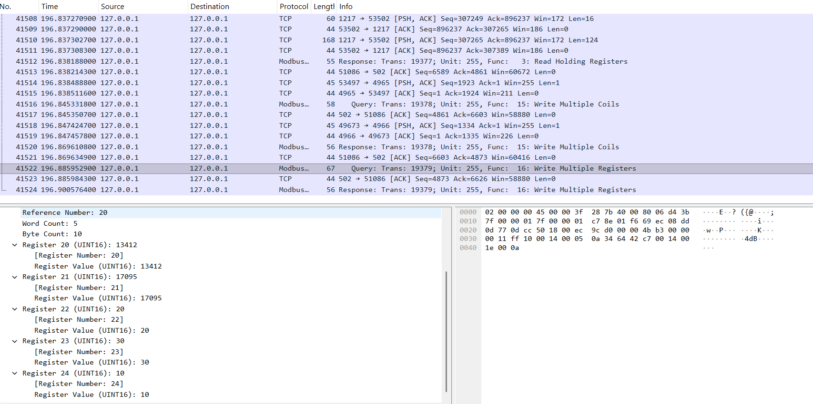

# Chemical Reactor Process Automation & Modbus TCP Diagnostics

Bu proje; CODESYS Control Win V3 çalışma zamanı (PLC) üzerinde Structured Text (ST) dili ile geliştirilmiş kimyasal reaktör proses otomasyonunu, Modbus TCP haberleşmesini ve Wireshark ağ analizini kapsamaktadır.

---

## 1. Mimari ve Modbus Fonksiyonları

- **Kontrolcü (Client):** CODESYS Control Win V3 x64
- **Saha Cihazı (Server):** Modbus TCP Slave Simülatörü (Port: 502)
- **Protokol:** TCP/IP (Modbus TCP)

### Kullanılan Modbus Fonksiyon Kodları:
- **FC 01 (Read Coils):** Sahadaki dijital buton durumlarının (startButon, stopButon) okunması.
- **FC 03 (Read Holding Registers):** Proses hedef sıcaklık parametresinin (hedefSicaklik) okunması.
- **FC 15 (Write Multiple Coils):** Aktüatör ve sürücü çıkışlarının (isitici, sogutucuVana, karistirici, sistemCalisiyor) toplu yazılması.
- **FC 16 (Write Multiple Registers):** Canlı sıcaklık, parti sayacı, çalışma süresi ve durum kodunun tek pakette sunucuya iletilmesi.

---

## 2. Bellek Mimarisi ve Veri Dönüşümü (DUT / UNION)

Modbus Holding Register'ları 16 bitlik (WORD) yapıdadır. Canlı sıcaklık verisi ise 32 bitlik kayan noktalı sayı (REAL / Float) formatındadır.

CODESYS üzerinde tanımlanan UNION yapısı ile 32-bit Float veri, çevrim kaybı olmadan iki adet 16-bit register'a paylaştırılmıştır:

```pascal
TYPE DUT :
UNION
    canliDeger : REAL;                  // 32-bit IEEE 754 Kayan Noktalı Sayı
    Words      : ARRAY[0..1] OF WORD;   // 2 x 16-bit Modbus Register'ı
END_UNION
END_TYPE
---
```
## 3. Wireshark ile Ağ ve Paket Analizi

Proses çalışırken loopback arayüzü (port 502) üzerinden Modbus TCP trafiği dinlenmiştir. Görselde, PLC'nin FC 16 (Write Multiple Registers) fonksiyonu ile 20 numaralı register'dan başlayarak proses verilerini (canlı sıcaklık, parti sayısı, çalışma süresi) tek pakette sunucuya başarıyla yazdığı doğrulanmaktadır.


